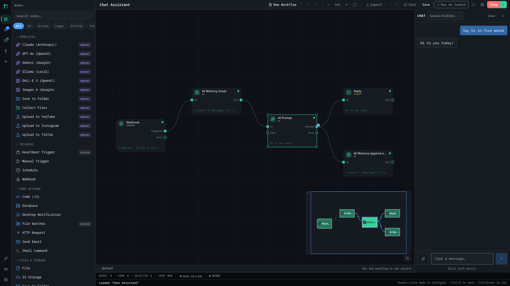
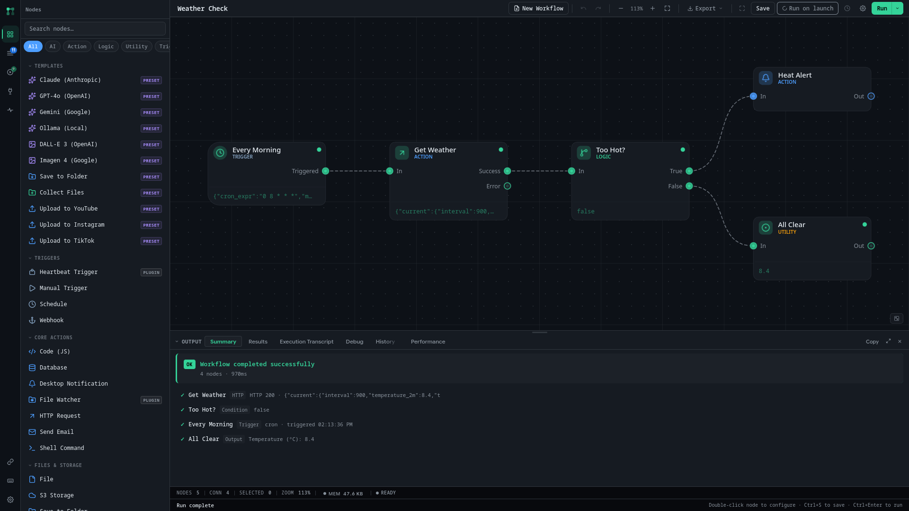
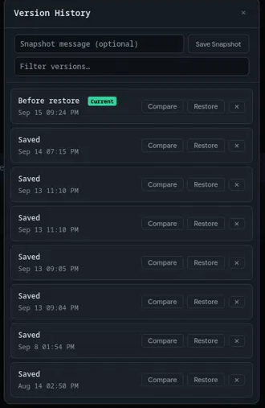
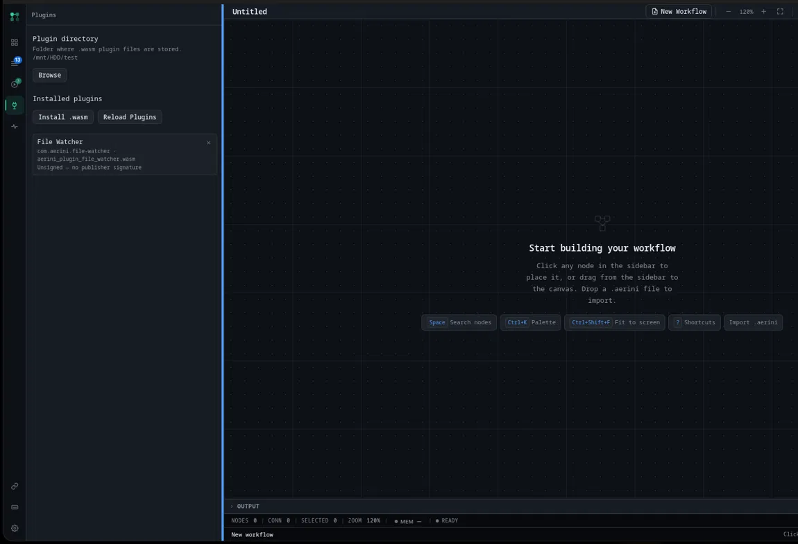
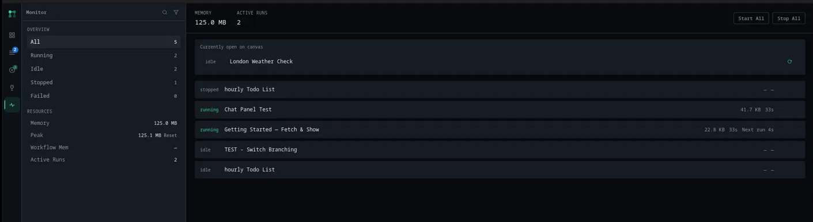

# Aerini

Aerini is a visual workflow automation app for macOS, Windows, and Linux. Drag nodes onto a canvas, wire them together, and run the result by hand, on a schedule, or from a webhook.

No account, no cloud, no subscription. Everything runs on your machine unless you point a node at something else.

Aerini is pre-1.0 and under active development. The workflow file format and internal APIs can still change before a 1.0 release.



Get it at **[aerini.org](https://aerini.org/)**, or from the [Releases page](https://github.com/Panchak2d/aerini/releases) if you'd rather skip the website. Docs are at **[docs.aerini.org](https://docs.aerini.org/)**, and the source is in [`docs/`](docs/index.md). Pricing for the commercial license is at [aerini.org/pricing](https://aerini.org/pricing).

**On this page:** [What it is](#what-aerini-is-and-isnt) · [Quick start](#quick-start-five-minutes) · [Use cases](#what-people-use-it-for) · [Building one](#building-one) · [Nodes](#40-nodes-seven-categories) · [Versions](#every-change-is-a-version-you-can-get-back) · [Plugins](#plugins) · [Background runs](#background-runs-and-keeping-an-eye-on-things) · [Server](#running-it-unattended) · [AI agents](#working-with-an-ai-agent) · [Engine](#using-the-engine-in-your-own-program) · [Install](#installing) · [Docs](#documentation) · [License](#license)

## What Aerini is, and isn't

A workflow is a set of **nodes** (small steps such as "call this URL", "send this email", "ask this model") connected in the order they should run. A **trigger** node starts it. If you've used Zapier, Make, or n8n the shape will feel familiar. The difference is where it runs: on your computer or your own server, not in a company's cloud.

Aerini is a good fit when:

- You have small, repetitive jobs ("check this every morning", "when X happens, do Y", "pull data from here and put it there") that you'd otherwise do by hand or write a script for.
- You want credentials, prompts, and data to stay on hardware you control.
- You want the same workflow to run on your desktop today and on a server next month, without rebuilding it.

Know the limits before you start:

- **No hosted service.** Something you run, your desktop or a server, has to be on for a scheduled or webhook-triggered workflow to fire.
- **One machine per workflow.** There's no built-in sync, and no hand-off of a run between machines.
- **It doesn't expose your machine to the internet.** A Webhook node listens on `127.0.0.1` only. Reaching it from outside needs a reverse proxy or a tunnel (`cloudflared`, `ngrok`); the Docker package from Export for Server includes a Caddy proxy for this.
- **Not a data platform.** No warehouse, no analytics, no large-scale batch processing. It's an automation tool for individuals and small setups.
- **Pre-1.0.** Expect the file format to change. Current limits and planned work are listed in [Known Issues](docs/known-issues.md).

## Quick start (five minutes)

You need the desktop app ([Installing](#installing)) and nothing else: no account, no API key.

1. Open Aerini and choose **Start with a blank canvas**.
2. Under **Triggers** in the left sidebar, click **Manual Trigger**.
3. Under **Core Actions**, click **HTTP Request**, then drag from Manual Trigger's right-hand dot to HTTP Request's left-hand dot. Double-click the node and set **URL** to `https://httpbin.org/get`, a public test service that echoes your request back.
4. Under **Utility**, click **Output** and connect HTTP Request to it.
5. Press **Run**. The panel under the canvas shows the response.

That's a complete workflow: a trigger, an action, and a place to see the result. [Getting Started](docs/getting-started/getting-started.md) continues from here and makes the same workflow run on its own every few seconds. If you'd rather start from something real, pick a recipe below.

## What people use it for

Every recipe below is built from nodes that ship with Aerini and behaviour documented in the linked pages. Where a ready-made walkthrough exists, it's linked. Where a recipe needs credentials, setting them up is covered in [Credentials](docs/guide/credentials.md).

### On your desktop

#### A price or stock watcher

Check a listing or API on a timer and message yourself only when the number crosses your threshold.

- **Flow:** Schedule → HTTP Request → If / Condition → Discord or Telegram. Wire the **False** branch to a Stop node so a quiet check ends silently.
- **How:** Set the Schedule to an interval (10 seconds is the minimum) or a cron expression such as `0 * * * *` for hourly. In the If node, set Left Value to the field you pulled from the response (for example `{{HTTP Request.output.body.price}}`), Operator to `<`, and Right Value to your number. Two numbers compare as numbers.
- **Needs:** a Discord webhook URL, or a Telegram bot token and chat ID. For a purely local alert, a Desktop Notification node works without any account.
- **Keep in mind:** the app must be running, though closing its window only hides it to the system tray. If the machine is asleep when a run is due, that run is skipped, not queued ([Background Runs](docs/guide/background-runs.md#skipped-runs-not-queued-runs)). Check that the site or API you poll allows automated requests.

#### A private daily summary

A local model condenses a notes file each night and saves the result to a folder. The prompt and the reply never leave your machine.

- **Flow:** Schedule (cron, for example `0 22 * * *`) → File (`read`) → AI Prompt (Provider `local`, pointed at Ollama) → Text to File (Markdown) → Save to Folder.
- **How:** File reads regular files up to 50 MB. In AI Prompt, click **Use Ollama defaults**, **Fetch Models**, and pick one you've already downloaded. Text to File turns the reply into a `.md` file that Save to Folder writes out.
- **Needs:** [Ollama](https://ollama.com/) and a downloaded model, no API key. The [Local Models Quickstart](docs/guide/local-models-quickstart.md) takes about 15 minutes, most of it waiting for the download.
- **Keep in mind:** speed and quality depend on your hardware and the model you choose. Models are multi-gigabyte downloads.

#### A scheduled email report

Pull one number from an API every weekday morning and email it to yourself or a team.

- **Flow:** Schedule (cron `0 8 * * 1-5`) → HTTP Request → Transform Data → Send Email.
- **Needs:** an SMTP account. The password is stored as a credential and picked from the Send Email node's Saved Credential dropdown.
- **Walkthrough:** [Scheduled Report](examples/Scheduled_Report___HTTP___Transform___Email.md).

#### A daily AI digest

Fetch the top Hacker News story each morning, summarise it with a model, and file it in Notion.

- **Flow:** Schedule → HTTP Request (story IDs) → HTTP Request (story detail) → AI Prompt → Notion.
- **Keep in mind:** give the two HTTP Request nodes different names. Two nodes left with the same name make an expression such as `HTTP Request.output...` resolve to whichever comes first, silently ignoring the other. The summary needs a rich-text column in your Notion database, because the Notion node writes database properties, not a page body.
- **Walkthrough:** [AI Pipeline](examples/AI_Pipeline___Schedule___Prompt___Notion.md).

### Self-hosted, running while your laptop is off

#### The same watcher on a server

Move a finished workflow to a cheap server or a home machine so it keeps running when your laptop is closed.

- **How:** open the workflow, then **Export → Export for Server**. The panel shows the trigger it read from the workflow and one row per credential it uses. Choose **Linux Server** (a zip with `install.sh` and a systemd service) or **Docker**, and run the command the panel shows (`./install.sh` or `docker compose up -d`).
- **Credentials:** only their *names* go into the package. You set the real values as environment variables on the server.
- **Keep in mind:** `install.sh` downloads the matching `aerini-server` release and checks its SHA-256 checksum, so no Rust is needed on x86-64 Linux. On another architecture, build from source or use the Docker package, which can build from source for an ARM server. Node.js is only needed there if the workflow has a Code (JS) node.
- **Details:** [Server Deployment](docs/operations/server-deploy.md).

#### A contact-form inbox

A form tool posts each submission to a Webhook workflow, which emails you and posts to Slack.

- **Flow:** Webhook → Send Email, and Webhook → Slack in parallel.
- **How:** the form tool must be able to send a webhook with a custom header. Tally can, for example. Set the Webhook's **Secret** first; callers send it in an `x-webhook-secret` header. For a public address, use the Docker export: it adds a Caddy proxy that serves HTTPS on ports 80 and 443 for the domain you set as `AERINI_DOMAIN` in `.env`, passes through only the webhook's path and method, and answers everything else with 404.
- **Keep in mind:** the Secret proves the caller knows it. It doesn't sign the body, so a captured request can be replayed. The **Dedup Window Secs** setting ignores a repeated identical body for a set time, which helps with providers that resend on a timeout. Open ports 80 and 443 at your cloud provider as well as the server's firewall.

#### GitHub push alerts

Post to Slack when someone pushes to `main`, and ignore everything else.

- **Flow:** Webhook → If / Condition (`{{Webhook.output.body.ref}} == refs/heads/main`) → Slack on True, Stop on False.
- **Keep in mind:** GitHub signs its payload with an HMAC in `X-Hub-Signature-256`. The Webhook node's Secret field does not check that, so putting the same value in both places does not verify anything. To verify GitHub's signature, add a Code node after the Webhook.
- **Walkthrough:** [Webhook Receiver](examples/Webhook_Receiver___GitHub___Slack_Notify.md).

### Behind an API

#### A deploy check called from CI

Your pipeline asks Aerini to test your site after a release and report the result.

- **Flow:** Manual Trigger → HTTP Request → If / Condition on the status → Slack.
- **How:** run `aerini-server api`, save the workflow with `POST /api/workflows`, create a token limited to that workflow, and have CI call `POST /api/workflows/:id/run` with `Authorization: Bearer <token>`.
- **Keep in mind:** the run is synchronous and returns the full result. A workflow that fails at runtime still returns HTTP `200` with `success: false`, so your pipeline must check the `success` field, not just the status code. In `api` mode, Shell Command, Code (JS), and Database nodes are disabled until you pass `--allow-shell`, `--allow-code`, or `--allow-database`.
- **Details:** [Server API Reference](docs/operations/server-api-reference.md), [Server CLI Reference](docs/operations/server-cli-reference.md).

### As a chat bot

#### A chat bubble on your site

A widget on your docs or product site answers from your own instructions and remembers the conversation.

- **Flow:** Webhook → AI Memory (read) → AI Prompt → AI Memory (append the user's message and the reply) → Output.
- **How:** on an empty canvas, **Chat bot template** adds a ready-wired Webhook, AI Prompt, and Output. Add AI Memory around the AI Prompt to carry history between messages. Then embed the widget script on your page.
- **Keep in mind:** read [Widget Embedding](docs/guide/widget-embedding.md) before you make one public. It covers token exposure and prompt injection.
- **Walkthrough:** [Chatbot with AI Memory and Widget](examples/Chatbot___AI_Memory___Widget.md); the short version is [Build a Chat Bot](docs/guide/chat-bot.md).

#### A desktop assistant for your files

Chat with a local model about files you attach, inside the desktop app, with no server.

- **How:** build the Webhook → AI Prompt → Output workflow, point AI Prompt at Ollama, and open the **Chat** panel. Attachments reach the workflow as `{{Webhook.output.files}}`, which you wire to AI Prompt's Files input.
- **Details:** [Chat Panel](docs/guide/chat-panel.md), [Chat with a Local Model](docs/guide/chat-with-a-local-model.md).

### With an AI agent

#### Have an assistant draft the workflow

Describe what you want to Claude and get a workflow file back to open on the canvas.

- **How:** install `aerini-mcp`, register it with Claude Code or Claude Desktop, and ask. The offline build looks up nodes, checks the workflow, and writes a `.aerini` file to `~/aerini-workflows`. It can't run anything or reach a network. You drag the file onto the canvas and review it before running.
- **Details:** [MCP Quickstart](docs/operations/mcp-quickstart.md), about 15 minutes with no server or token.

#### Let a model use tools, with checks in between

An AI Agent node can ask for tools, but it doesn't run them. Your workflow decides what happens.

- **Router:** an AI Agent asks for one of two tools, an If node rejects an unknown tool or bad arguments, a Switch runs the right branch, and a second AI Agent answers from the result. The number of model calls is fixed and visible. Import [`AI_Agent_Router.aerini`](examples/AI_Agent_Router.aerini).
- **Loop:** the same pattern inside a Loop, so the agent keeps going until it answers. The list length sets the turn budget, and **Stop When** ends the loop early. Import [`AI_Agent_Loop.aerini`](examples/AI_Agent_Loop.aerini).
- **Keep in mind:** the Loop pattern was tested on Gemini; other providers are untested in a Loop. There's no token budget or time limit. Read each walkthrough's safety rules before wiring a model's tool arguments into other nodes: [Router](examples/AI_Agent_Router.md), [Loop](examples/AI_Agent_Loop.md).

### Inside your own program

#### Rules and custom nodes in a Rust app

Run user-defined "when this happens, do that" rules, or add your own node types, by depending on `aerini-engine`. See [Using the engine in your own program](#using-the-engine-in-your-own-program).

If it can be described as "when this happens, do these steps," it's a workflow.

### Ready-made examples

| Example | Shape | Ships as |
| - | - | - |
| [Getting Started: Fetch and Show](examples/README.md) | Schedule every 10 seconds → HTTP Request → Output | Docker package (`.zip`) |
| [Scheduled Report](examples/Scheduled_Report___HTTP___Transform___Email.md) | Schedule → HTTP → Transform → Email | Walkthrough |
| [Webhook Receiver](examples/Webhook_Receiver___GitHub___Slack_Notify.md) | Webhook → If → Slack / Stop | Walkthrough |
| [AI Pipeline](examples/AI_Pipeline___Schedule___Prompt___Notion.md) | Schedule → HTTP ×2 → AI Prompt → Notion | Walkthrough |
| [Chatbot with AI Memory and Widget](examples/Chatbot___AI_Memory___Widget.md) | Webhook → AI Memory → AI Prompt → Output | Walkthrough |
| [AI Agent Router](examples/AI_Agent_Router.md) | AI Agent → If → Switch → tool → AI Agent | Walkthrough + `.aerini` file |
| [AI Agent Loop](examples/AI_Agent_Loop.md) | Loop around an AI Agent with tool branches | Walkthrough + `.aerini` file |

To import a `.aerini` file, drag it onto the canvas, or click the import button on an empty canvas. It's always added as a new workflow and never overwrites one you have. See [Examples](docs/guide/examples.md) for the full list.

## Building one

The left sidebar lists every node, grouped by category, with search and one-click presets for the AI providers and platforms you'll reach for most (Claude, GPT, Gemini, Ollama, DALL-E 3, Imagen 4, plus ready-to-go Save to Folder and Upload nodes). Drop nodes on the canvas, connect their ports, hit Run. The panel underneath shows a summary, the raw results, an execution transcript, a debug view, and run history, so when something fails you're not guessing where.



Conditions branch with True/False outputs, a Loop node runs a sub-flow once per item, and Switch handles more than two paths. Anything downstream can pull in an upstream node's output with `{{Node Name.output.field}}`; see [Expressions](docs/guide/expressions.md) for the full syntax.

A few habits that save time:

- **Run once by hand first.** **Run** executes the workflow once, right now, and shows the result. Turn on a schedule only after a manual run looks right.
- **Give nodes distinct names.** Expressions refer to nodes by name, so two nodes with the same name are ambiguous.
- **Keep secrets in Credentials.** Store API keys under **Settings → Credentials** and pick them from a node's Saved Credential dropdown, instead of pasting them into a field.
- **Branch with Stop.** End a branch you don't care about with a Stop node. Other independent branches keep going.

## 40 nodes, seven categories

| Category | Nodes |
| - | - |
| **Triggers** | Manual Trigger, Webhook, Schedule |
| **Core Actions** | HTTP Request, Shell Command, Code (JS), Send Email, Desktop Notification, Database |
| **Files & Storage** | File, Save to Folder, S3 Storage, Social Upload |
| **Integrations** | Slack, Discord, GitHub, Google Sheets, Notion, Telegram, SendGrid, Stripe |
| **AI** | AI Prompt, AI Agent, AI Memory, Text Splitter, Image Generation |
| **Logic** | If / Condition, Switch, Loop (For Each), Stop, Merge, Collect Files |
| **Utility** | Delay, Wait, Transform Data, JSON, Set Variable, Get Variable, Text to File, Output |

Notes on a few of them:

- **Schedule** runs on an interval, a cron expression, or once at a set time.
- **Webhook** starts a workflow when a request hits a local address, and can check a shared secret, reject stale timestamps, and ignore duplicate bodies.
- **Database** runs SQL against SQLite, PostgreSQL, or MySQL, or key-value operations against Redis.
- **S3 Storage** works with AWS S3, Cloudflare R2, and MinIO.
- **AI Prompt** and **AI Agent** talk to Claude, GPT, Gemini, or a local server such as Ollama. AI Agent can also search the web, return structured JSON, and ask for tools.
- **Shell Command, Code (JS), and Database** are the dangerous nodes. They're off by default on a server until you opt in. See [Security](docs/guide/security.md).

Full parameters and outputs for each one: [Nodes Reference](docs/guide/nodes.md).

## Every change is a version you can get back

Aerini snapshots your workflow automatically as you edit, and you can save a named snapshot yourself before trying something risky. Version History compares any two snapshots field by field and restores either one. No more "I changed something three days ago and can't remember what."



## Plugins

Node types you write yourself. Compile a Rust crate to `wasm32-wasip2`, then either drop the `.wasm` file (or an `.aerinipkg` bundle, if it's more than one node) onto the Aerini window, or install it from the dedicated Plugins panel. It shows up in the palette tagged as a Plugin, right next to the built-ins.

Each plugin call runs sandboxed in its own Wasmtime instance: no filesystem access, a 64 MiB memory cap, and a 30-second wall-clock deadline per call. Outbound HTTP is allowed but filtered the same way built-in nodes are, so a plugin can't be used to reach your internal network. Aerini shows a signature status for every installed plugin (unsigned is normal for most community plugins, not a red flag by itself) and surfaces load errors instead of silently dropping a bad build.



Start with [Plugin Authoring](docs/development/plugin-authoring.md), or copy `examples/plugin-template/`. To install and manage one, see [Plugins](docs/guide/plugins.md).

## Background runs and keeping an eye on things

A workflow with a Schedule, Webhook, or trigger-plugin trigger keeps running while you work on something else. You don't need the canvas open. The Background Runs panel lists everything currently running, idle, or stopped; the Monitor panel next to it tracks memory use and lets you start or stop everything at once.



Two ways to run a workflow:

| | **Run** | **Background run** |
| - | - | - |
| Starts | When you click | On its trigger: a timer or an incoming request |
| Runs | Once | Repeatedly, owned by Aerini's scheduler |
| Needs the canvas open | Yes | No |
| Result | Shown right there | Recorded in run history |

Closing Aerini's window just hides it to the system tray, and everything keeps running. Choosing **Quit Aerini** from the tray menu stops everything, and a run caught mid-way shows up in run history as Interrupted. More on triggers and run history: [Background Runs](docs/guide/background-runs.md).

## Running it unattended

Aerini itself is built for one person on one machine, but a workflow can run without the desktop app open. `aerini-server` is the headless binary for that, and it has two modes:

| Mode | What it runs | Pick it when |
| - | - | - |
| `serve` | One workflow exported from the desktop app, with its own run history and status page | You have one or two workflows and want the fewest moving parts |
| `api` | Many workflows behind a REST API with bearer-token auth, scoped tokens, and its own encrypted credential store | You run more than a handful, or another program needs to create and run workflows |

Click **Export → Export for Server** on a workflow to generate a `serve`-mode deployment package. The Linux Server target produces a zip with an installer script, a systemd service and your workflow's configuration. On x86-64 Linux, `install.sh` downloads the matching `aerini-server` release and checks its SHA-256 checksum, so no Rust is needed; on another architecture, build it from source (see [Server Deployment](docs/operations/server-deploy.md#building-aerini-server-from-source)) and put it in the unzipped folder first, or use the Docker package, which can build from source for an ARM server (the prebuilt image is x86-64 only). Node.js is only needed for Code (JS) nodes.


`api` mode is for when one exported workflow isn't enough. Get it with `docker pull ghcr.io/panchak2d/aerini-server`, download the Linux binary from the [Releases page](https://github.com/Panchak2d/aerini/releases), or build it yourself (Docker or from source) if you want to customize it. Both modes bind `127.0.0.1` by default. Full details: [Server Deployment](docs/operations/server-deploy.md), [Server CLI Reference](docs/operations/server-cli-reference.md), and [Server API Reference](docs/operations/server-api-reference.md).

## Working with an AI agent

`aerini-mcp` is a [Model Context Protocol](https://modelcontextprotocol.io/) server that lets an AI agent such as Claude Code or Claude Desktop look up what Aerini's nodes can do, write a workflow, check it, save it, and, against an `aerini-server api` instance, run it. It is a separate small program, downloaded from the [Releases page](https://github.com/Panchak2d/aerini/releases), that the agent's client starts itself. It carries your token's scope and workflow access list, and anything that changes the server needs an explicit `--allow-write`. Without a server, an offline build writes `.aerini` files you drag onto the desktop canvas and never runs anything. 

Start with the [MCP Quickstart](docs/operations/mcp-quickstart.md), which needs no server or token. Setup and what to lock down first: [MCP Server for AI Agents](docs/operations/mcp.md). How an agent should use it: [Building Workflows with an AI Agent](docs/guide/agents.md).

## Using the engine in your own program

`aerini-engine` is a plain Rust crate: no Tauri, no UI dependency. Pull it into your own program, register your own nodes alongside or instead of the 40 built-ins, supply your own credential resolver and event sink, and run workflows headless. It's the same engine behind the desktop app and `aerini-server`, so retries, parallel execution, expressions, and plugins all behave the same way embedded as they do anywhere else.

See [Embedding aerini-engine](docs/development/embedding.md) for a working example and what's safe to depend on across versions.

## Requirements (building from source)

| Tool | Version | Why |
| - | - | - |
| Rust (stable) | 1.96+ | Builds the engine and desktop shell |
| Node.js | 20.19+ or 22.12+ to build; 22.12+, 24, or 26+ to run the tests | Only to run the frontend build and tests, not needed to use the app itself |
| Tauri CLI | 2.x | Packages the desktop app |

The Code (JS) node runs on a Node.js runtime bundled inside Aerini. You don't need Node.js installed to use that node, only to build Aerini from source.

## Installing

Download the installer for your OS from **[aerini.org](https://aerini.org/)**, or grab the same files from the [Releases page](https://github.com/Panchak2d/aerini/releases): `.dmg` for macOS, `.msi` or `.exe` for Windows, `.deb` or `.AppImage` for Linux. No terminal needed.

A few things worth knowing before your first launch:

- **macOS** builds are Apple Silicon only right now, no Intel build yet. The app isn't signed with an Apple Developer certificate, so right-click it and choose Open the first time instead of double-clicking, or Gatekeeper will block it. macOS may also ask for Keychain access to read the key that decrypts your saved credentials. Choose **Always Allow** (see [Known Issues](docs/known-issues.md)).

- **Windows** installers aren't code-signed either, so SmartScreen will warn you. Click "More info," then "Run anyway." Normal for a project this size, not a sign anything's wrong.

- **Linux** needs `webkit2gtk` 4.1, which most desktops already have. If Aerini won't launch and complains about a missing shared library, install `webkit2gtk-4.1` first (e.g. `libwebkit2gtk-4.1-0` on Debian/Ubuntu).

Once it's running, work through the [Quick start](#quick-start-five-minutes) above or [Getting Started](docs/getting-started/getting-started.md). To update later, open **Settings → About → Check for Updates**; see [Updating](docs/operations/updating.md). Aerini 0.4.1 and earlier have no in-app updater.

### Building from source

```
git clone https://github.com/Panchak2d/aerini
cd aerini
npm install
./scripts/fetch-node-binaries.sh
npm run dev
```

`fetch-node-binaries.sh` downloads and checksum-verifies the Node.js runtime Aerini bundles for the Code (JS) node. It's a one-time step per clone and the build fails without it. Needs `curl`, `tar`, `unzip` (or `powershell.exe` on Windows), and `sha256sum`/`shasum` on your PATH.

The first build takes a few minutes while Rust compiles. After that, changes rebuild in seconds. `npm run build:unsigned` produces a standalone installer under `src-tauri/target/release/bundle/`.

> `dist/` is committed on purpose, Tauri reads frontend assets from it at build time. Don't add it to `.gitignore`. Details in [CONTRIBUTING.md](CONTRIBUTING.md).

## Common questions

**Does it send data anywhere?** No telemetry, analytics, or crash reports. See [Privacy](#privacy).

**Does it work offline?** Yes, for anything that doesn't call an outside service. A Schedule fires on your machine's own clock. Only nodes that talk to something external need a connection.

**Do I need to code?** No. Nodes are configured through forms. The Code (JS) node is optional.

**Where is my data?** In one per-OS data folder on the machine Aerini runs on. Credentials are stored encrypted, with the key in your OS keyring. See [Credentials](docs/guide/credentials.md).

**Is there a mobile app?** No. Desktop for macOS, Windows, and Linux, plus the headless `aerini-server`.

**Can I share a workflow?** Yes. **Export** saves a `.aerini` file, and dragging one onto the canvas imports it with a preview first.

More: [FAQ](docs/faq.md). Something broken: [Troubleshooting](docs/troubleshooting.md).

## Documentation

Browse and search everything at **[docs.aerini.org](https://docs.aerini.org/)**. The same pages live in [`docs/`](docs/index.md) in this repository.

| Guide | What it covers |
| - | - |
| [Introduction](docs/index.md) | What Aerini is, who it's for, what it can't do |
| [Installation](docs/getting-started/installation.md) | Downloading and installing on each OS |
| [Getting Started](docs/getting-started/getting-started.md) | Build your first workflow, run it, schedule it |
| [Concepts](docs/getting-started/concepts.md) | What a workflow is, what a node is, how it fits together |
| [Glossary](docs/glossary.md) | Every term used across these docs, defined plainly |
| [Nodes Reference](docs/guide/nodes.md) | Every built-in node: parameters, outputs, what it does |
| [Keyboard Shortcuts](docs/guide/keyboard-shortcuts.md) | Every shortcut, grouped the same way as the in-app list |
| [Expressions](docs/guide/expressions.md) | `{{...}}` syntax for wiring node outputs into other nodes |
| [Credentials](docs/guide/credentials.md) | Storing API keys and setting up every supported service |
| [Background Runs](docs/guide/background-runs.md) | Schedules, webhook triggers, run history |
| [Version History](docs/guide/version-history.md) | Automatic and named snapshots, comparing, restoring |
| [Plugins](docs/guide/plugins.md) | Installing and managing a `.wasm` plugin node |
| [Monitor](docs/guide/monitor.md) | Memory use and run status across every workflow at once |
| [Examples](docs/guide/examples.md) | Worked example workflows in [`examples/`](examples/) |
| [Troubleshooting](docs/troubleshooting.md) | Common problems, by symptom |
| [FAQ](docs/faq.md) | Short answers to common questions |
| [Known Issues](docs/known-issues.md) | Current limits with no fix yet, and planned work |
| [Security](docs/guide/security.md) | Encryption, dangerous nodes, SSRF protection, hardening a server |
| [Chat Panel](docs/guide/chat-panel.md) | Chatting with a workflow inside the desktop app |
| [Build a Chat Bot](docs/guide/chat-bot.md) | A Webhook, AI Prompt and Output bot, from the template or by hand |
| [Widget Embedding](docs/guide/widget-embedding.md) | Dropping the chat widget into a web page |
| [Local Models Quickstart](docs/guide/local-models-quickstart.md) | A first reply from a model running on your own machine, step by step |
| [Local Models](docs/guide/local-models.md) | Using Ollama and other OpenAI-compatible local servers |
| [Chat with a Local Model](docs/guide/chat-with-a-local-model.md) | Building a workflow and chatting with it in the Chat Panel |
| [Server Deployment](docs/operations/server-deploy.md) | Running workflows 24/7 on Docker or a Linux box |
| [Server CLI Reference](docs/operations/server-cli-reference.md) | Every `aerini-server serve`/`api` flag |
| [Server API Reference](docs/operations/server-api-reference.md) | REST endpoints, SSE events, scoped tokens |
| [MCP Quickstart](docs/operations/mcp-quickstart.md) | Letting an AI assistant draft workflows for you, with no server |
| [MCP Server for AI Agents](docs/operations/mcp.md) | Installing `aerini-mcp`, configuring Claude Code and Claude Desktop, limits, what to lock down |
| [Building with an AI Agent](docs/guide/agents.md) | The order an agent should work in, and what to keep a person in charge of |
| [Updating](docs/operations/updating.md) | Desktop updates, server binary updates, workflow schema migration |

Developer guides:

| Guide | What it covers |
| - | - |
| [Architecture](docs/development/architecture.md) | How the engine, Tauri shell, and server binary fit together |
| [Embedding aerini-engine](docs/development/embedding.md) | Using the engine as a Rust library in your own program |
| [Custom Node Authoring](docs/development/node-authoring.md) | Adding a new built-in node type |
| [Plugin Authoring](docs/development/plugin-authoring.md) | Writing and distributing `.wasm` plugin nodes |
| [Desktop IPC Reference](docs/development/desktop-ipc-reference.md) | Every command the frontend can call into the Tauri shell |
| [Workflow File Format](docs/reference/workflow-file-format.md) | The `.aerini`/`.json` schema |
| [Schema Migrations](docs/reference/schema-migrations.md) | How the workflow format changes across versions |
| [Testing](docs/development/testing.md) | Where tests live and how to run them |

## License

[GNU Affero General Public License v3.0](LICENSE) (AGPL-3.0).

- You can use, modify, and self-host Aerini freely.

- If you distribute a modified version of Aerini — including running a modified `aerini-server` as a network service for others — you have to publish those modifications under AGPL-3.0 too.

- Running the **unmodified** binary as an internal tool for your own team doesn't trigger that.

### Need a commercial license?

A commercial license removes the copyleft obligation for one named product or service of yours: no source disclosure, proprietary modifications allowed, and no limit on that product's end customers. Each additional product needs its own license. The license also requires you to pass its AI-training restriction on to your own end customers. You probably want one if you're building a product or SaaS on top of Aerini, distributing a modified copy to clients, running a modified `aerini-server` as a service for others, or your legal team wants a license certificate on file. You accept the terms electronically at checkout and the certificate is issued automatically, so there is nothing to sign. The software itself is provided as-is, with no warranty.

[Pricing](https://aerini.org/pricing) · [License terms](https://aerini.org/license-terms) · [`COMMERCIAL-LICENSE.md`](COMMERCIAL-LICENSE.md) · enterprise or volume licensing: [CONTACT.md](CONTACT.md)

See [Why Aerini is dual-licensed](docs/dual-licensing.md) for the reasoning behind this model, including why a CLA is required from contributors.

## Privacy

No telemetry, no analytics, no crash reports. The only outbound connection Aerini's own interface makes on its own is loading the Inter font from Google Fonts over HTTPS, plus one update check per launch if you turn on the off-by-default **Check on startup** setting. Everything else is whatever your workflows are configured to do. See [Security §Desktop security model](docs/guide/security.md#desktop-security-model), or the [transparency report template](transparency/TEMPLATE.md) for the full audit trail.

## Contributing

Contributions welcome, see [CONTRIBUTING.md](CONTRIBUTING.md). A CLA is required before your first PR merges. CLA Assistant posts a one-click sign link on the PR itself, GitHub OAuth, takes a few seconds.

## Community & support

- Questions, workflow help, feature ideas: [GitHub Discussions](https://github.com/Panchak2d/aerini/discussions)

- Bugs: [GitHub Issues](https://github.com/Panchak2d/aerini/issues)

- Funding development directly: [Patreon](https://www.patreon.com/c/Panchak2d)
