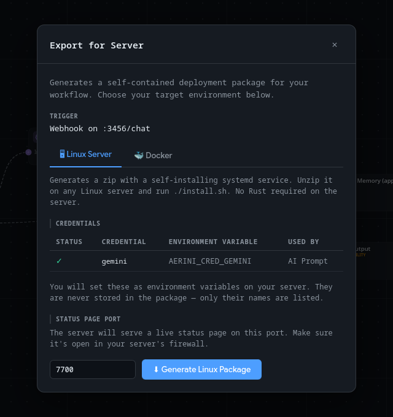
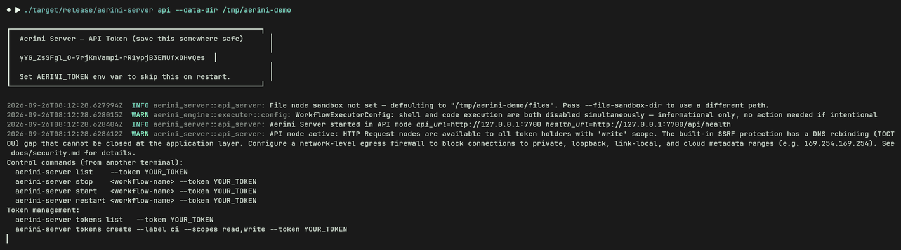
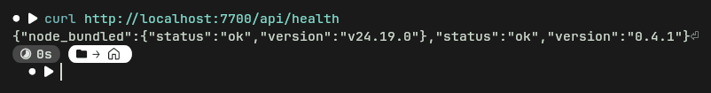
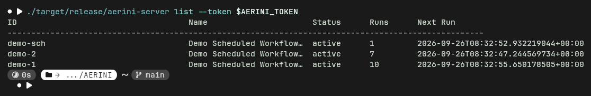
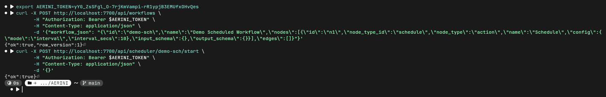

# Server Deployment

`aerini-server` is the headless binary that runs Aerini without the desktop app. It has two modes: `serve`, which runs one workflow exported from the desktop app, and `api`, which runs a full multi-workflow REST server. This page covers getting either one running, on Docker or on a bare-metal Linux box. For the security model behind the flags used here (SSRF protection, dangerous-node gating, credential encryption), see [Security §Hardening a server deployment](../guide/security.md#hardening-a-server-deployment); that page explains the *why*, this one covers the *how*. An exhaustive flag and REST route reference lives in [Server CLI Reference](server-cli-reference.md) and [Server API Reference](server-api-reference.md); this page sticks to what you need to get a deployment running and keep it running.

## Choosing a mode

Export a single workflow from the desktop app (**Export → Export for Server**, covered in [Background Runs §Beyond the desktop app](../guide/background-runs.md#beyond-the-desktop-app)) and you get `serve` mode: one workflow, its own run history, a status page, no other configuration to manage. This is the right choice if you have one or two workflows and want the least amount of moving parts.

`api` mode runs many workflows behind a real REST API with bearer-token auth, its own encrypted credential store, and scoped tokens (`read`/`write`/`admin`). It has no desktop-generated export package. You run it directly and create workflows through the API (or a future admin UI). Choose this if you're running more than a handful of workflows on one box, or you need another program to create and manage workflows programmatically.

Both modes bind `127.0.0.1` by default, disable Shell Command, Code (JS), and Database nodes until you explicitly pass `--allow-shell` / `--allow-code` / `--allow-database`, and print a warning if you widen either of those defaults without acknowledging the tradeoff. None of that is repeated here; see the security page linked above.

### The Export for Server panel

With a workflow open on the canvas, **Export → Export for Server** opens a panel that generates the `serve`-mode package `serve` mode itself runs (below). It shows:



- **Trigger**: what the exported package will start on, read straight from the workflow, for example `Webhook on :3456/webhook` or a schedule's interval.
- **🖥 Linux Server / 🐳 Docker tabs**: which package format to generate, not which server mode. Both tabs still export the same single-workflow `serve` mode described throughout this page; the Docker tab's output is the self-contained image covered in [§The desktop's "Export for Server → Docker" package](#the-desktop-s-export-for-server-→-docker-package) below, a different thing from `api` mode's own `docker-compose.yml`.
- **Credentials**: one row per credential the workflow actually references, a ✓ or ⚠ showing whether it's currently filled in on the desktop app, the environment variable name it'll export as, and which node uses it. Only names are ever written into the package; you set the real values as environment variables on the server yourself. If the workflow also uses a `{{$vars.x}}` variable, a **Required variables** table above this one lists each one's suggested environment key the same way.
- **Status page port**: the port the exported package's status page listens on, `7700` by default, must be between `1024` and `65535`. On the Docker tab this maps that port on the host; the container always listens on `7700` internally regardless of what you set here.

Click **Generate Linux Package** or **Generate Docker Package**, choose where to save the zip, and the panel tells you the exact next command to run (`./install.sh`, or `docker compose up -d`). The steps below pick up from there.

## Getting the `aerini-server` binary

A prebuilt `aerini-server` container image is published to [GHCR](https://github.com/Panchak2d/aerini/pkgs/container/aerini-server) with every release, tagged with the release version and `latest`: `docker pull ghcr.io/panchak2d/aerini-server:<version>` is the fastest way to get a working binary, no clone or build step needed. Every [release](https://github.com/Panchak2d/aerini/releases) also publishes a static Linux x86-64 build as `aerini-server_<version>_x86_64-unknown-linux-musl.tar.gz`, with a `.sha256` file beside it; it runs on any x86-64 Linux distribution. Check it before running it: `sha256sum -c aerini-server_<version>_x86_64-unknown-linux-musl.tar.gz.sha256`. A checksum from the same page proves the download is intact, not who published it. The Linux Server zip from Export for Server doesn't contain the program, but its `install.sh` downloads and checks the release that matches the desktop version that exported the package, then installs it; if the program is already in the folder, it uses that one instead. That download is only published for x86-64 Linux; on any other architecture, or for a desktop build that has no release, build from source or use the Docker image. If you want to customize the image itself rather than run it as published, build it locally instead: `docker compose up --build`, or build from source, both covered below.

## Docker (recommended)

This image is self-contained: the build stage compiles `aerini-server` as a static musl binary and fetches a matching Node.js runtime for Code (JS) nodes, and the runtime image ships both side by side, so nothing needs installing on the host.

The fastest way to run it is to pull the published image directly, no clone needed:

```bash
docker run -d --name aerini \
  --restart unless-stopped \
  -p 127.0.0.1:7700:7700 \
  -e AERINI_TOKEN=$(openssl rand -base64 32) \
  -v aerini_data:/data \
  ghcr.io/panchak2d/aerini-server:latest
```

`--restart unless-stopped` brings the container back after a crash or a reboot of the host, but not after you stopped it yourself. The default policy is `no`, so without the flag the container stays down after a reboot. The policy only helps if the Docker service itself starts at boot: on Debian and Ubuntu it does by default, and on other systemd distributions you enable it with `sudo systemctl enable docker.service containerd.service`. To run the same published image with Compose, save this as `docker-compose.yml` next to a `.env` that sets `AERINI_TOKEN`, and start it with `docker compose up -d`:

```yaml
services:
  aerini:
    image: ghcr.io/panchak2d/aerini-server:latest
    ports:
      - "127.0.0.1:7700:7700"
    volumes:
      - aerini_data:/data
    environment:
      AERINI_TOKEN: ${AERINI_TOKEN:?Set AERINI_TOKEN in .env or environment}
      AERINI_TRUSTED_PROXY_COUNT: ${AERINI_TRUSTED_PROXY_COUNT:-0}
    restart: unless-stopped

volumes:
  aerini_data:
```

Replace `latest` with a release version to decide yourself when the server updates; see [Updating](updating.md#official-docker-image).

If you want to customize the `Dockerfile` itself, the repository also ships it with a matching `docker-compose.yml` at its root, and building it locally works the same way:

```bash
git clone https://github.com/Panchak2d/aerini
cd aerini
cp .env.example .env   # set AERINI_TOKEN (32+ characters: openssl rand -base64 32)
docker compose up -d
```

`docker-compose.yml` requires `AERINI_TOKEN` to be set (it fails fast with a clear error if you skip this) and publishes the port as `127.0.0.1:7700:7700`, host-loopback only. Either way, the image defaults to `api` mode and answers its health check on `GET /api/health`. Widen `127.0.0.1:7700` to `0.0.0.0:7700` only once you've read the SSRF and `--trusted-proxy-count` guidance in [Security](../guide/security.md#hardening-a-server-deployment), and put a reverse proxy with TLS in front rather than exposing this port directly.

### Running `serve` mode in the official image

The image's `ENTRYPOINT` is `aerini-server` itself; only the default `CMD` (`api`) is Compose-specific. To run `serve` mode instead, mount your exported `aerini-server.json` into `/data` and override the command:

```yaml
services:
  aerini:
    build: .
    ports:
      - "127.0.0.1:7700:7700"
    volumes:
      - ./aerini-server.json:/data/aerini-server.json:ro
      - aerini_data:/data
    environment:
      RUST_LOG: info
    command: ["serve", "--config", "/data/aerini-server.json", "--bind", "0.0.0.0"]
    restart: unless-stopped

volumes:
  aerini_data:
```

`--bind 0.0.0.0` here is the container's internal listen address, not a host-facing exposure setting. Docker only forwards what the `ports:` mapping publishes; the actual boundary is still the `127.0.0.1:7700:7700` line above.

### The desktop's "Export for Server → Docker" package

The **Docker** tab in the Export for Server panel generates a `docker-compose.yml` that runs the official image above, pinned to the release that exported the package, and starts it with `serve` on a fixed container port (the port you chose is only the host side of the mapping). It needs no build and no Rust. The image is published for x86-64 only and only for released versions; for an ARM server, a fork, a branch, or a version whose image does not exist, the package also holds `docker-compose.build.yml` and `Dockerfile.source`, and `docker compose -f docker-compose.yml -f docker-compose.build.yml up --build -d` builds from source instead. That source build is a different Dockerfile: one that `git clone`s the Aerini repository at build time and produces a plain `debian:bookworm-slim` image, rather than reusing the official one. It downloads and checksum-verifies the same pinned Node.js runtime the official image uses (from the cloned repository's own `NODE_VERSION` file) and places it next to `aerini-server` as `node-bundled`, which is the only place Aerini's Code node ever looks for it (it never searches `PATH`, and never did; see below). A workflow with a Code (JS) node runs the same way in this package as it does in the official image above, once `--allow-code` is set. Workflows without Code nodes are unaffected either way.

## Bare metal (Linux)

### Building `aerini-server` from source

`aerini-server` builds like any other crate in the workspace; you don't need Tauri's desktop dependencies (`webkit2gtk` and friends) to build it, only Rust and one system library:

```bash
git clone https://github.com/Panchak2d/aerini
cd aerini
sudo apt install -y libdbus-1-dev   # Debian/Ubuntu; needed for OS-keyring support
cargo build --release -p aerini-server
```

Rust 1.96+ is required to build `aerini-server` and the desktop app, as [Installation](../getting-started/installation.md#building-from-source) states. The compiled binary lands at `target/release/aerini-server`. This does not build or fetch a Node.js runtime; see the Code node section below if your workflow needs one.

### `serve` mode

Unzip the package from Export for Server (**Export → Export for Server → 🖥 Linux Server**; a fresh Ubuntu server may not have `unzip`, so run `sudo apt install unzip` first) then either run `./install.sh` (on x86-64 Linux it downloads and checks `aerini-server` if the folder doesn't already hold one, otherwise put the binary you built next to it first; installs a systemd user service, handles `.env`, tries to enable lingering so it survives logout and reboot, and if the system refuses it prints the one command to run, `sudo loginctl enable-linger $USER`, which you must run or the service will not start after a reboot; the service listens on `127.0.0.1`, so reach it over an SSH tunnel or [a reverse proxy](#tls-with-a-reverse-proxy)) or run it directly:

```bash
./aerini-server serve --config aerini-server.json --port 7700
```

The status page, plain HTML at `/`, is public by default and shows workflow name, run count, last/next run. `POST /api/run` (manual trigger), `GET /api/logs` (the last 50 entries; `?n=` takes 1 to 1000), and `GET /api/runs` all require the `run_secret` you set at export time, sent as `Authorization: Bearer <run_secret>`. If the workflow contains a File node, pass `--file-sandbox-dir` or File nodes can read and write anywhere the server process can reach; if it contains Shell Command, Code, or Database nodes, they stay disabled until you pass the matching `--allow-*` flag after auditing the workflow (the generated `aerini.service` and `README.txt` both name the exact flag needed, but neither adds it for you).

### The `aerini-server.json` file

The export writes one config file, and `serve` mode reads it at start-up. You rarely edit it, but every field is plain JSON:

| Field | What it holds |
|---|---|
| `workflow_name` | Name shown on the status page. |
| `workflow_json` | The whole workflow, in the same format the desktop app saves. |
| `status_port` | Port for the status page. `--port` overrides it. |
| `exported_at` | When the package was generated, shown on the status page. |
| `credential_env_vars` | Maps each saved credential's ID to the environment variable the server reads its secret from. |
| `run_secret` | argon2id hash of the secret that guards `POST /api/run`, `/api/logs` and `/api/runs`. Optional: with no `run_secret` those endpoints stay disabled. The raw secret is shown once in the desktop app and is not in this file. |

`credential_env_vars` looks like this:

```json
"credential_env_vars": {
  "openai-prod": "AERINI_CRED_OPENAI_PROD",
  "slack-bot":   "AERINI_CRED_SLACK_BOT"
}
```

The export fills it in from the credentials your workflow uses, and the generated `.env.example` lists the same variables. Set each one in the server's environment (the `.env` file the systemd unit loads, `docker run -e`, the `environment:` block in Compose) before starting. The file holds names only, never secrets.

Rules the server checks at start-up:

- It reads only the variables listed in the mapping. A credential ID that isn't in it is not looked up by its name, so a node using that credential runs with the field left empty and a warning in the log.
- Every variable name must start with `AERINI_CRED_`, followed by uppercase letters, digits or underscores. This stops the file from pointing a credential at an unrelated variable such as `AERINI_TOKEN`.
- Two credential IDs can't share one variable.
- Each variable must be set, non-empty and valid Unicode.

You can edit a variable name to match how you store secrets, for example `AERINI_CRED_OPENAI_PROD` to `AERINI_CRED_OPENAI_LIVE`, as long as you keep the prefix and set the new name in the environment. Don't change the credential ID keys, since they must match the IDs inside `workflow_json`. Re-exporting from the desktop app regenerates the file and overwrites such edits.

If `serve` refuses to start, [Troubleshooting](../troubleshooting.md#aerini-server-serve-refuses-to-start-over-credentials) lists the messages and fixes.

### `api` mode

No export package or config file; everything is flags or environment variables.

```bash
export AERINI_TOKEN=$(openssl rand -base64 32)
./aerini-server api --port 7700
```

`AERINI_TOKEN`/`--token` must be at least 32 characters; the server refuses to start otherwise. Leave it unset on first run and the server generates one for you and prints it once to stderr, along with a reminder to set `AERINI_TOKEN` so a restart doesn't discard it. That first token is granted all three scopes (`read`, `write`, `admin`); create narrower tokens for anything you don't fully trust:

```bash
./aerini-server tokens create --label ci --scopes read,write --token $AERINI_TOKEN
```

Changing `AERINI_TOKEN` does not replace the token it held before: the server adds each value to its token store the first time it starts with it, and the earlier one stays valid until you revoke it. A token you revoked stays revoked even if `AERINI_TOKEN` still holds it. To rotate the first token, create a new one with `--scopes read,write,admin`, use that one to run `tokens revoke <token_id>` on the old one (its id is in `tokens list`; a call can't revoke the token it authenticates with), then set `AERINI_TOKEN` to the new value.

Once running, manage workflows from another terminal without touching the REST API directly:

```bash
./aerini-server list                              --token $AERINI_TOKEN
./aerini-server stop    <workflow-name-or-id>      --token $AERINI_TOKEN
./aerini-server start   <workflow-name-or-id>      --token $AERINI_TOKEN
./aerini-server restart <workflow-name-or-id>      --token $AERINI_TOKEN
```

These accept a partial name or ID match and only fail if that's ambiguous, in which case they print every candidate so you can be specific.

### Code (JS) nodes need a bundled runtime, not a system Node install

Aerini's Code node never searches `PATH` for `node`, on the desktop app or on the server. It looks for exactly one thing: a binary named `node-bundled` (or `node-bundled.exe` on Windows) sitting in the same directory as the running executable, or an `AERINI_NODE_BIN` environment variable pointing at a Node binary directly. A system-wide `apt install nodejs` alone will not make Code nodes work. `install.sh` checks for exactly those two things and prints a note when neither is set up, but only for a workflow that contains a Code node. Building from source doesn't fetch Node.js either; only the official Docker image and the desktop's Docker export do that automatically. To make Code nodes work in a bare-metal deployment, do one of:

`<workflow>` in these paths is the workflow's name in lowercase letters and digits, with every run of other characters replaced by one hyphen and at most 48 characters, so `My Flow!` becomes `my-flow`. The service is named `aerini-<workflow>`.

```bash
# Option A: point at any working Node.js install (simplest)
echo 'AERINI_NODE_BIN=/usr/bin/node' >> ~/.aerini-server/<workflow>/.env

# Option B: place a binary literally named node-bundled next to aerini-server
cp "$(command -v node)" ~/.aerini-server/<workflow>/node-bundled
```

Either works for `serve` mode's systemd service (`.env` is loaded via `EnvironmentFile=`) or for `api` mode (export `AERINI_NODE_BIN` in the shell or unit that starts it). Workflows without Code nodes are unaffected either way.

## Credentials

`serve` mode never touches the encrypted credential store the desktop app uses. It reads environment variables instead, one per credential, named and generated automatically at export time; see [Credentials §Running headless](../guide/credentials.md#running-headless-aerini-server-and-environment-variables) for the exact naming rule and the generated `.env.example`.

`api` mode is different: it has its own encrypted credential store (`POST`/`GET`/`DELETE /api/credentials`, gated by `write`/`read` scope), separate from both the desktop app's store and `serve` mode's environment variables. Pass `--keychain` to back its encryption key with the OS keyring (falls back to a file automatically, with a warning, if the keyring isn't available); without it, the key lives in a file under `--data-dir`. If credentials are already saved and the key can't be found (the key file was deleted, or the keyring entry is gone with no fallback file), the server exits with an error instead of creating a new key that can't decrypt them. Restore the original key file; deleting `credentials.db` as well starts an empty store.

## Webhook workflows

A workflow that starts on a Webhook node listens on `127.0.0.1:<webhook port>` only, never on a public address (Aerini's webhook listener has no setting for that). From outside the machine it is reachable only through a proxy running next to it. The status page in `serve` mode is separate and has its own port.

**Docker export.** The package from **Export → Export for Server → Docker** does this for you when the trigger is a Webhook. The listener's loopback address is inside the container, which Docker cannot publish, so the generated `docker-compose.yml` adds a `caddy` service that joins the app container's network namespace (`network_mode: "service:aerini-<name>"`). Caddy then reaches the listener at its own `127.0.0.1`, and because it shares the app's network, ports 80, 443 and 443/udp are published on the app service. The package's `Caddyfile` passes through only the webhook's path and method and answers everything else with 404; the status page is not reachable through it. To use it, point a DNS name at the server, set `AERINI_DOMAIN` in `.env`, open ports 80 and 443 (also in your cloud provider's firewall, since Caddy needs them to get its certificate), and run `docker compose up -d`. The export refuses a path with characters other than letters, digits and `/ _ . ~ -`, and a webhook port of 7700, which is the status page's port inside the container.

**Bare metal.** Both programs are on the same host, so any proxy can reach the listener. With Caddy, put this in `/etc/caddy/Caddyfile`, with your domain, the webhook's own port and path, and the method if the node restricts one:

```
hooks.example.com {
    @webhook {
        path /webhook
        method POST
    }
    handle @webhook {
        reverse_proxy 127.0.0.1:3456
    }
    handle {
        respond 404
    }
}
```

Set a secret in the Webhook node. Without one the listener accepts every request, and a public proxy then lets anyone on the internet run the workflow; callers send the secret in the `x-webhook-secret` header.

## TLS with a reverse proxy

`aerini-server` speaks plain HTTP, so anything reachable from outside the machine should sit behind a reverse proxy that terminates TLS, while the server itself stays on loopback: the `127.0.0.1:7700:7700` mapping in the Docker examples above, or the default `--bind 127.0.0.1` on bare metal.

[Caddy](https://caddyserver.com/docs/install) is the shortest route, because it fetches and renews a certificate by itself. It needs a domain name whose DNS record points at the server, and ports 80 and 443 open to the internet and directed to Caddy. Put this in `/etc/caddy/Caddyfile`, replacing the name with yours, then run `sudo systemctl reload caddy`:

```
aerini.example.com {
	reverse_proxy 127.0.0.1:7700
}
```

Caddy adds the client's address to `X-Forwarded-For` and ignores one the client sent itself. Tell Aerini that one proxy sits in front, or per-IP rate limiting counts every client as the proxy's own address and they all share one allowance (see [Security §Hardening a server deployment](../guide/security.md#hardening-a-server-deployment)): set `AERINI_TRUSTED_PROXY_COUNT=1` (a line in `.env` for the Compose files above, `-e AERINI_TRUSTED_PROXY_COUNT=1` for `docker run`, or `--trusted-proxy-count 1` on bare metal). Caddy passes the long-lived `GET /api/events` stream through without delay.

With nginx, the same job takes more settings. `X-Forwarded-For` has to be appended to, the event stream must not be buffered, and `POST /api/workflows/:id/run` returns only when the run finishes, so the read timeout has to be longer than your longest run (nginx's default is 60 seconds). Get the certificate with your usual tool, for example Certbot, and add:

```
server {
    listen 443 ssl;
    server_name aerini.example.com;
    # ssl_certificate and ssl_certificate_key from your certificate tool

    location / {
        proxy_pass http://127.0.0.1:7700;
        proxy_set_header Host $host;
        proxy_set_header X-Forwarded-For $proxy_add_x_forwarded_for;
        proxy_buffering off;
        proxy_read_timeout 1h;
    }
}
```

The count is the same, `1`, with one nginx in front. If you chain a second proxy or a CDN in front of that, raise it to match, as the security page explains.

## Firewall

On an Ubuntu or Debian VPS, ufw is the usual way to close everything except what the proxy needs. Allow SSH before you enable it, or you lock yourself out of a remote machine (use your own port if SSH isn't on 22):

```bash
sudo ufw allow ssh
sudo ufw allow 80/tcp
sudo ufw allow 443/tcp
sudo ufw enable
sudo ufw status
```

ufw denies incoming traffic by default, so port 7700 stays closed. That only holds because Aerini listens on loopback: Docker publishes a port through its own firewall rules, ahead of ufw's, so a container started with `-p 7700:7700` or `0.0.0.0:7700:7700` is reachable from outside no matter what ufw says. Keep the `127.0.0.1:` prefix in the port mapping, as every example on this page does. For limiting what Aerini itself may connect to, see the egress rule in [Security](../guide/security.md).

## Backup and restore

`api` mode keeps its state in one data folder: `/data` in the container, `--data-dir` or `AERINI_DATA_DIR` otherwise (default `~/.aerini-server`). It holds the workflows, schedules, run history and saved versions (`aerini.db`), the saved credentials (`credentials.db`), the key that decrypts them (`aerini.key`, unless you used `--keychain` on bare metal), the token store (`tokens.db`, `tokens.key`), AI Memory conversations (`ai_memory.db`) and the default File node sandbox (`files/`). A backup of `credentials.db` without `aerini.key` cannot be read, and anyone holding both can read your credentials, so keep the backup off the server and treat it like a password. Stop the server first so the database files are copied in one piece.

For the Docker examples above, with the volume named `aerini_data`:

```bash
docker stop aerini
docker run --rm -v aerini_data:/data:ro -v "$PWD":/backup busybox:1.38-musl \
  tar czf /backup/aerini-data.tar.gz -C /data .
docker start aerini
```

A Compose project prefixes the volume name with the project name, usually the folder name; `docker volume ls` shows the real one. To restore into an empty volume, for example on a new server:

```bash
docker volume create aerini_data
docker run --rm -v aerini_data:/data -v "$PWD":/backup busybox:1.38-musl \
  sh -c 'tar xzf /backup/aerini-data.tar.gz -C /data && chown -R 65532:65532 /data'
```

Then start the container as usual. `65532` is the user the image runs as. Restoring over a volume that already holds data replaces it: remove the container and the volume first only if you mean to discard what is there.

On bare metal, stop the server and archive the data folder: `tar czf aerini-data.tar.gz -C ~ .aerini-server`, then extract it the same way. A `serve` export keeps its history in `aerini-serve.db` next to `aerini-server.json`, in the folder `install.sh` created; archive that folder. If only the encryption key was lost, [`restore-key`](server-cli-reference.md#restore-key) puts a backed-up key back.

## Verifying the deployment

Starting `api` mode with no token set prints the auto-generated one once, along with a couple of startup warnings (the file sandbox default, and [SSRF](../glossary.md#ssrf)'s DNS-rebinding gap, both explained in full in [Security](../guide/security.md#hardening-a-server-deployment) and [Server CLI Reference §`api`](server-cli-reference.md#api)) and the control/token-management commands from [§`api` mode](#api-mode):



Both `api` and `serve` mode answer `GET /api/health` with no authentication required, returning the engine version and whether the bundled Node.js runtime actually spawns (in `serve` mode it is on the status page port, `7700` by default):

```bash
curl http://localhost:7700/api/health
```



`serve` mode also has the status page at `/` and `GET /api/status` (unauthenticated for the non-sensitive fields, `run_secret`-gated for `last_error`) if you want run state rather than a liveness check. The official image's Docker health check calls `/api/health`, so `docker inspect --format '{{.State.Health.Status}}' <container>` reports `healthy` in either mode.

`./aerini-server list` confirms `api` mode sees every workflow you've created and their next scheduled run:

```bash
./aerini-server list --token $AERINI_TOKEN
```



Everything above also works as plain REST calls instead of the CLI wrapper, useful if another program needs to create or start a workflow rather than a person running a command. Creating a workflow this way needs its `workflow_json` double-encoded, the JSON document as a JSON *string* value, since `POST /api/workflows` takes the whole workflow as one field:



See [Server API Reference §Workflows](server-api-reference.md#workflows) for the full request/response shape of both routes.

## Updating

There's no in-place binary updater for `aerini-server`. The official Docker image updates by pulling a newer tag and recreating the container; bare metal updates by replacing the binary, and the desktop's generated Docker export updates by exporting the package again from a newer app (or, for a source build, by rebuilding). See [Updating §Server (`aerini-server`)](updating.md#server-aerini-server) for the exact commands for each of the three shapes above (official Docker image, bare metal, and the desktop's generated Docker export, whose optional source build has a cache gotcha the other two don't), plus what happens when a workflow's schema version doesn't match the binary loading it.

## What's next

- [Server CLI Reference](server-cli-reference.md), for every flag on both subcommands
- [Server API Reference](server-api-reference.md), for the full REST route table
- [MCP Server for AI Agents](mcp.md), for letting an AI agent build and run workflows against an `api` instance
- [Security](../guide/security.md), for the reasoning behind the defaults this page just tells you how to use
- [Credentials](../guide/credentials.md), for the desktop-side credential store `api` mode's own store doesn't share
- [Background Runs](../guide/background-runs.md), for exporting a workflow from the desktop app in the first place
